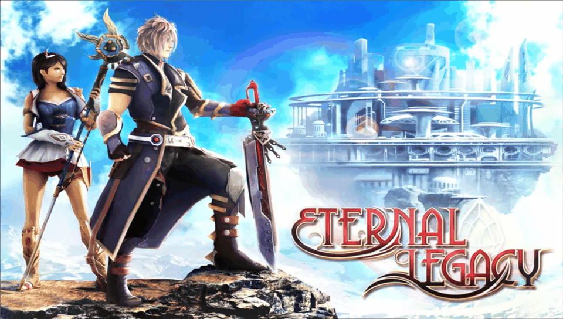

# Eternal Legacy — PS Vita Port

<p align="center">
  
</p>

<p align="center">
  <b>Native port of Eternal Legacy HD (Gameloft) for PlayStation Vita and PlayStation TV.</b>
</p>

<p align="center">
  
  
  
  
  
</p>

---

## 📖 Description

**Eternal Legacy** is Gameloft's acclaimed turn-based 3D JRPG, originally released for Android (v1.0.8, package `com.gameloft.android.ANMP.GloftELHP`). 

This port runs the compiled native Android library (`libEternalLegacy.so`, armeabi) directly on the PlayStation Vita's ARM Cortex-A9 CPU using a dynamic library loader (*soloader*) based on TheFloW's architecture, a tailored Android runtime emulation layer (*FalsoJNI*), and [vitaGL](https://github.com/Rinnegatamante/vitaGL) for hardware-accelerated OpenGL ES 2.0 graphics.

---

## 🎮 Current Status: Playable (Beta)

The game boots, saves, loads, and is playable in-game at 30 FPS with full audio and controls. See [`port_progress.md`](port_progress.md) for full development and debugging logs.

### ✨ What Works
- **Native ARM Execution:** `libEternalLegacy.so` runs natively on bare metal with softfp ABI compatibility.
- **Hardware-Accelerated 3D Graphics:** GLES 2.0 rendering powered by vitaGL with runtime GLSL shader translation and caching (`DATA_PATH/shader_cache`).
- **Complete Audio System:** Gameloft Vox sound engine routed via a JNI `AudioTrack` implementation to `sceAudioOut` (44100 Hz stereo 16-bit PCM).
- **Physical Controls & Touch Support:** Mapped analog sticks and face buttons for seamless handheld gameplay, alongside full front touch screen support.
- **Filesystem Optimization (`dat/NN/` layout):** Resolves the PS Vita kernel's FAT directory traversal bottleneck (~2600 flat files) using grouped subdirectories generated by `pack_data.py`.
- **Script & Quest Fixes:** Restored missing `functionmacro.lua` helpers to ensure all quests, cutscenes, and arena triggers execute correctly.
- **Save & Load:** In-game state saving and auto-saves functioning properly.

---

## ⚠️ Known Issues

1. **Visual Artifact (Stretched Vertex / Cyan Beam):**
   - As documented in the test screenshots (`screenshots/`), an elongated cyan/blue polygonal bar stretches across the screen near the protagonist's waist level during exploration, cutscenes, and menus. This is an active rendering glitch under investigation (likely a vertex attribute, bone skinning matrix, or weapon trail/shadow volume misinterpretation in the shader pipeline).
2. **Intro Video Playback:**
   - The opening / logo FMV (`LOGO_Gameloft_960x640.mp4`) does not currently play on boot. It is temporarily bypassed via `Get_logoVideoState` until video playback via `SceAvPlayer` is integrated.
3. **Lighting / Overexposure:**
   - Certain doorways and outdoor areas exhibit overexposed lighting or missing depth occlusion.

---

## 🕹️ Controls

| Vita Input | In-Game Action | Menu / Cutscene Action |
|---|---|---|
| **Left Analog / D-Pad** | Character Movement | Menu Navigation |
| **Right Analog** | Camera Rotation | — |
| **Cross ($\times$)** | Action / Interact (Talk, Open, etc.) | Advance Dialogue / Confirm |
| **Circle ($\bigcirc$)** | — | Back / Cancel (in menus) |
| **Start** | Pause Menu / System Menu | — |
| **Touch Screen** | Original Virtual Controls & UI Interaction | UI Touch Selection |

---

## 📋 Requirements & Setup

### Prerequisites
1. PlayStation Vita or PlayStation TV running Custom Firmware (**HENkaku** or **Enso** on 3.60 or 3.65).
2. [**kubridge.skprx**](https://github.com/TheOfficialFloW/kubridge/releases) installed in your taiHEN `config.txt` under `*KERNEL`.
3. [**fd_fix.skprx**](https://github.com/TheOfficialFloW/FdFix/releases) (or rePatch) installed under `*KERNEL`.
4. [**libshacccg.suprx**](https://samilops2.gitbook.io/vita-troubleshooting-guide/shader-compiler/extract-libshacccg.suprx) installed in `ur0:data/libshacccg.suprx` (can be extracted with *ShaRKBR33D*).

### Data Preparation
1. Obtain a legal copy of **Eternal Legacy v1.0.8** (`Eternal_Legacy_1.0.8.apk`) and its Android game cache (`GloftELHP`).
2. Extract `libEternalLegacy.so` from `lib/armeabi/libEternalLegacy.so` inside the APK.
3. Copy `libEternalLegacy.so` to `ux0:data/eternallegacy/`.
4. Use the provided Python script to prepare the game data and bundle script fixes:
   ```bash
   python3 extras/pack_data.py "Eternal_Legacy_1.0.8 gameloft cache.zip" ux0_data/eternallegacy
   ```
5. Transfer the contents of `ux0_data/eternallegacy/` to `ux0:data/eternallegacy/` on your PS Vita via FTP or USB (VitaShell):
   - `ux0:data/eternallegacy/libEternalLegacy.so`
   - `ux0:data/eternallegacy/GloftELHP/`
   - `ux0:data/eternallegacy/dat/`
6. Install `eternallegacy.vpk` on your console.

---

## 🛠️ Building from Source

To compile the loader from source, ensure you have the [VitaSDK](https://vitasdk.org/) environment set up:

```bash
mkdir build && cd build
cmake ..
make -j$(nproc)
```

This will produce `eternallegacy.vpk` and `eboot.bin`.

---

## 👥 Credits

- **TheFloW** for the original `so_loader` concept, `kubridge`, and `fd_fix`.
- **Rinnegatamante** for [vitaGL](https://github.com/Rinnegatamante/vitaGL), shader tools, and advice.
- **v-atamanenko** for `soloader-boilerplate` and FalsoJNI improvements.
- **Gameloft** for developing *Eternal Legacy*.
