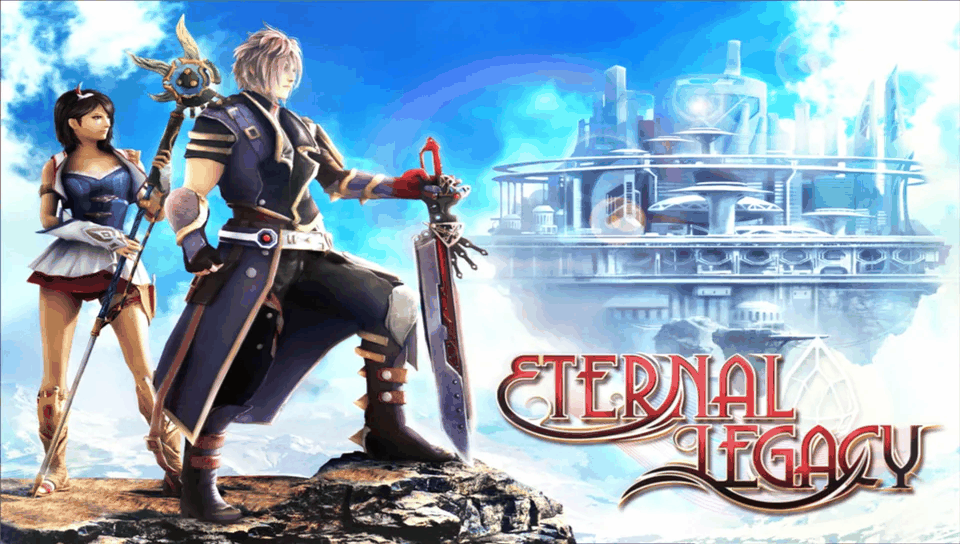

<h1 align="center">
  <br>
  Eternal Legacy · PS Vita Port
</h1>

<p align="center">
  <b>Native port of Eternal Legacy HD (Gameloft) for PlayStation Vita and PlayStation TV.</b>
</p>

<p align="center">
  
  
  
  
  
  
</p>

<p align="center">
  <a href="#-description">Description</a> •
  <a href="#-features">Features</a> •
  <a href="#-controls">Controls</a> •
  <a href="#-installation">Installation</a> •
  <a href="#-known-issues">Known Issues</a> •
  <a href="#-building-from-source">Build</a> •
  <a href="#-credits">Credits</a>
</p>

---

## 📖 Description

**Eternal Legacy** is Gameloft's turn-based 3D JRPG, originally released for Android (v1.0.8, package
`com.gameloft.android.ANMP.GloftELHP`).

This port runs the compiled native Android library (`libEternalLegacy.so`, armeabi) directly on the PS Vita's ARM
Cortex-A9 CPU, using a dynamic library loader (*soloader*) based on TheFloW's architecture, an Android runtime emulation
layer (*FalsoJNI*), and [vitaGL](https://github.com/Rinnegatamante/vitaGL) for OpenGL ES 2.0 graphics. The engine is
Gameloft's *glitch* engine (derived from Irrlicht) with *gameswf* for the Flash UI and *Vox* for audio.

---

## 🎮 Status & Playability

**Status: In-game (beta, v1.0.0)**. The game boots on hardware, loads its menus and reaches the in-game areas, and a
saved game loads on the console (log 014). Several items below are still unverified, and the physical-control path is
still in progress.

- [x] **Boot & loader**: `JNI_OnLoad`, vitaGL init and the main loop run on the console (logs 002 and 010 onward). *Verified on console.*
- [x] **Data loading**: the `ftell` after `fseek(SEEK_END)` fix that unblocks the data decryption is confirmed on the console (Bug #006, log 010). *Verified on console.*
- [ ] **Menu load time**: the menu voice load (about 1800 voices, Bug #007) was still under diagnosis in the notes; the `fopen` directory-scan fix is not confirmed as complete.
- [x] **Save & load**: a save written in log 013 was loaded in log 014. *Verified on console.*
- [ ] **Quests & arena**: the `functionmacro.lua` helpers are repaired; the quest chain has to be re-run from a **new game** to confirm (Bug #008).
- [ ] **Physical controls**: the stick-to-touch mapping is in progress (Bug #009) and not yet tested on the console.
- [ ] **Frame rate**: the release notes say 30 FPS; no measurement is recorded in `port_progress.md`. <!-- TODO: measure and record FPS -->

### What Works

- **Native ARM execution**: `libEternalLegacy.so` runs natively on the Vita with softfp ABI compatibility.
- **Hardware-accelerated 3D graphics**: GLES 2.0 rendering through vitaGL with runtime GLSL shader translation and caching (`DATA_PATH/shader_cache`).
- **Audio**: the Vox sound engine's output goes through a JNI `AudioTrack` implementation to `sceAudioOut` (44100 Hz stereo 16-bit PCM).
- **Touch**: the engine is touch-driven; the original touch UI and virtual controls are wired to the Vita touch screen.
- **Filesystem optimization (`dat/NN/` layout)**: the ~2600 flat data files are grouped into subdirectories by
  `pack_data.py`, to avoid the slow directory traversal of the Vita's FAT filesystem.
- **Script and quest fixes**: restored `functionmacro.lua` helpers, so quests, cutscenes and arena triggers can run.
- **Saves**: in-game and auto-save go to `ux0:data/eternallegacy/saves/`; a saved game loads on hardware.

### Changelog

**v1.0.0 — Initial beta release** (`release.md`, `CMakeLists.txt` `VITA_VERSION` 01.00)
- Native ARM execution of `libEternalLegacy.so` on the Vita CPU, with the release notes quoting 30 FPS. <!-- TODO: measured FPS -->
- Hardware GLES 2.0 rendering via vitaGL, with GLSL shader translation and runtime caching.
- Audio mixer output through an Android AudioTrack JNI bridge to `sceAudioOut` (44100 Hz stereo).
- Physical controls: analog stick movement, camera control and button bindings alongside the original touch input
  (see Bug #009 for the status of the physical-control mapping).
- `pack_data.py` groups the ~2600 data files into `dat/NN/` subdirectories.
- Reconstructed `functionmacro.lua` helpers, so cutscenes, NPC dialogs and chapter progression run without soft-locking.
- Autosave and manual save slots (save and load verified on console, see Status above).

---

## ✨ Features

| Feature | Status | Notes |
| :--- | :---: | :--- |
| Boots to gameplay | ✅ | Boots, loads menus and reaches the in-game areas on hardware (logs 002–014) |
| Graphics / renderer | 🟡 | GLES 2.0 via vitaGL with shader translation. Known rendering artifacts: cyan beam and overexposed doorways (see Known Issues) |
| Audio & music | 🧪 | Vox → AudioTrack → `sceAudioOut` path; the AudioTrack port opens on hardware; playback quality not recorded yet |
| Video / cutscenes | ❌ | The opening logo FMV (`LOGO_Gameloft_960x640.mp4`) is bypassed via `Get_logoVideoState`; no `SceAvPlayer` pipeline yet |
| Physical buttons | 🧪 | Mapping in progress (Bug #009): Cross, Circle and Start → touch and menu events. Not tested on the console |
| Analog sticks / camera | 🧪 | Left stick and D-Pad → synthetic touch on the virtual joystick; right stick → camera drag. Not tested on the console |
| Touch screen | 🧪 | The engine is touch-only; touch triggers (quests, arena) were reached on hardware in logs 013–014 |
| Button remapping / port menu | ➖ | Not implemented |
| Save data | ✅ | A save written in log 013 was loaded in log 014 on hardware |
| Native trophies | ➖ | No trophy data in the repository |
| Languages | 🧪 | Not tested yet |
| Performance | 🧪 | 30 FPS claimed in the release notes; no measurement recorded yet <!-- TODO: measure --> |
| Online / IAP / ads | 🧪 | Not tested yet. The license-check stack overflow (Bug #001) is fixed and confirmed on the console (log 002) |
| PS TV | 🧪 | Not tested yet |

Legend: `✅ Working (verified on console) · 🧪 Implemented, not yet verified on console · 🟡 Partial · ❌ Not working · ➖ Not applicable · ❔ Not documented yet`

---

## 🎯 Controls

| Vita Input | In-Game Action | Menu / Cutscene Action |
|---|---|---|
| **Left Analog / D-Pad** | Character movement | Menu navigation |
| **Right Analog** | Camera rotation | — |
| **Cross (×)** | Action / interact (talk, open, etc.) | Advance dialogue / confirm |
| **Circle (○)** | — | Back / cancel (in menus) |
| **Start** | Pause menu / system menu | — |
| **Touch Screen** | Original virtual controls & UI interaction | UI touch selection |

---


## 📋 Prerequisites

1. PlayStation Vita or PlayStation TV running Custom Firmware (**HENkaku** or **Enso** on firmware 3.60 or 3.65).
2. [**kubridge.skprx**](https://github.com/TheOfficialFloW/kubridge/releases) installed in your taiHEN `config.txt` under `*KERNEL`.
3. [**fd_fix.skprx**](https://github.com/TheOfficialFloW/FdFix/releases) (or rePatch) installed under `*KERNEL`.
4. [**libshacccg.suprx**](https://samilops2.gitbook.io/vita-troubleshooting-guide/shader-compiler/extract-libshacccg.suprx) installed in `ur0:data/libshacccg.suprx` (can be extracted with *ShaRKBR33D*).

## 📦 Installation

### Data Preparation

1. Obtain a legal copy of **Eternal Legacy v1.0.8** (`Eternal_Legacy_1.0.8.apk`) and its Android game cache (`GloftELHP`).
2. Extract `libEternalLegacy.so` from `lib/armeabi/libEternalLegacy.so` inside the APK.
3. Copy `libEternalLegacy.so` to `ux0:data/eternallegacy/`.
4. Use the packing script to prepare the game data and bundle the script fixes:
   ```bash
   python3 extras/pack_data.py "Eternal_Legacy_1.0.8 gameloft cache.zip" ux0_data/eternallegacy
   ```
5. Transfer the contents of `ux0_data/eternallegacy/` to `ux0:data/eternallegacy/` on your PS Vita via FTP or USB (VitaShell):
   - `ux0:data/eternallegacy/libEternalLegacy.so`
   - `ux0:data/eternallegacy/GloftELHP/`
   - `ux0:data/eternallegacy/dat/`
6. Install `eternallegacy.vpk` on your console (VitaShell).

### Final File Layout in `ux0:data/eternallegacy/`

```text
ux0:data/eternallegacy/
├── libEternalLegacy.so   <- lib/armeabi/ of the APK
├── GloftELHP/            <- Android game cache (from the cache archive)
├── dat/                  <- packed data (dat/00/, dat/01/, ...) from pack_data.py
├── saves/                <- created automatically (save games)
├── logs/                 <- created automatically (eternallegacy_NNN.log)
└── shader_cache/         <- created automatically (vitaGL shader cache)
```

---

## 🐛 Known Issues

1. **Visual artifact (stretched vertex / cyan beam)**: an elongated cyan/blue polygonal bar stretches across the screen near
   the protagonist's waist level during exploration, cutscenes and menus (see the test screenshots in `screenshots/`).
   This is an active rendering glitch under investigation (likely a vertex attribute, bone skinning matrix, or weapon
   trail / shadow volume misinterpretation in the shader pipeline). It also appears in the release notes as a stretched
   polygon / bloom issue.
2. **Intro video playback**: the opening Gameloft logo FMV (`LOGO_Gameloft_960x640.mp4`) does not play. It is bypassed via
   `Get_logoVideoState` until video playback via `SceAvPlayer` is integrated.
3. **Lighting / overexposure**: certain doorways and outdoor areas show overexposed lighting or missing depth occlusion.
4. **Quest chain needs a new game**: a save from before the Lua helper fix loads with the quest events already consumed
   (Bug #008, log 014). Start a new game to test the arena chain.
5. **Physical controls untested**: the mapping in Bug #009 has not been run on the console yet.
6. **Logs and crash dumps**: the game writes `ux0:data/eternallegacy/logs/eternallegacy_NNN.log`. Crash dumps (`.psp2dmp`)
   are written by the system to `ux0:data/`. Attach both when you report an issue on GitHub.
7. **Missing data**: if the game reports missing data, make sure `ux0:data/eternallegacy/GloftELHP/` and
   `ux0:data/eternallegacy/dat/00/file000000.dat` exist (the loader also prints a clear error when `GloftELHP/` is missing).

---

## 🔨 Building from Source

To compile the loader from source, make sure the [VitaSDK](https://vitasdk.org/) environment is set up:

```bash
git clone https://github.com/MetalSyntax/Eternal-Legacy-vita.git
cd Eternal-Legacy-vita
mkdir build && cd build
cmake ..
make -j$(nproc)
```

This produces `eternallegacy.vpk` and `eboot.bin`.

---

## 📁 Project Structure

- `source/`: loader, JNI bridge (`java.c`), input (`input.c`), reimplementations under `source/reimpl/` (AudioTrack over `sceAudioOut` in `audiotrack.c`, threads in `pthr.c`), and `source/utils/init.c` (creates `saves/` and `logs/`).
- `lib/`: auxiliary libraries (`so_util`, `falso_jni`, `kubridge`, `libc_bridge`, `fios`, `sha1`).
- `extras/pack_data.py`: packs the game data into `dat/NN/` subdirectories and bundles the script fixes (`extras/data_fixes/`).
- `extras/livearea/`: LiveArea assets.
- `screenshots/`, `logs/`: test captures and device logs from development.
- `PORTING_PLAN.md`: porting plan. `port_progress.md`: bug-by-bug log. `release.md`: release notes.

---

## 📜 Disclaimer

**Eternal Legacy** and **Gameloft** are trademarks of Gameloft. This project is unofficial and is not produced, endorsed or
sanctioned by Gameloft.

This software does NOT contain original game code, binaries, graphics or other game assets. The authors do not promote or
condone piracy in any way. To play, you must provide your own legally obtained copy of the game (`.apk` and cache archive).

---

## ☕ Support My Work

This project is **free** and will stay free. If you enjoy it, a tip from **$1** helps me keep porting games to the PS Vita:

<p align="center">
  <a href="https://ko-fi.com/metalsyntax"></a>
</p>

- **Ko-fi:** [ko-fi.com/metalsyntax](https://ko-fi.com/metalsyntax)
- **PayPal:** [paypal.me/MetalSyntax](https://paypal.me/MetalSyntax)
- **Bitcoin (BTC):** `133HdCsaWxdjTfmwpgGVykByhNBV338uRc`

**Ko-fi supporters get:**
- **Early access** to new ports before their public release (test builds of upcoming projects).
- **Data preparation scripts and step-by-step guides** to set up your own game files for each new port.
- A say in which games I port next.

> Game files are never distributed. You always need your own legally obtained copy of the game.

---

## 👥 Credits

- **Gameloft**: original developer of *Eternal Legacy*.
- **TheFloW**: for the original `so_loader` concept, `kubridge` and `fd_fix`.
- **Rinnegatamante**: for [vitaGL](https://github.com/Rinnegatamante/vitaGL), shader tools and advice.
- **v-atamanenko**: for `soloader-boilerplate`, FalsoJNI and its improvements.
- **MetalSyntax**: this port.

---

## 📄 License

The loader code is licensed under the MIT License. See [LICENSE](LICENSE) for the full text
(Copyright (C) 2021 Andy Nguyen, Copyright (C) 2021-2022 Rinnegatamante, Copyright (C) 2022-2024 Volodymyr Atamanenko).
The game, its assets and its `.so` files remain the property of their owners and are not distributed with this project.
